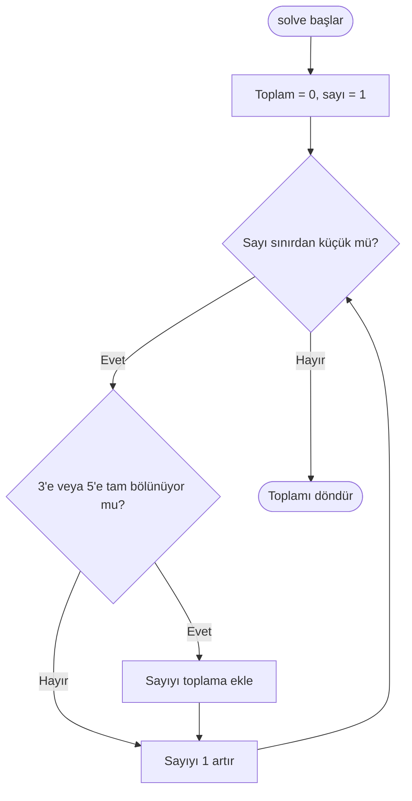

# Problem 1 — 3 veya 5'in katları

[Kod dosyası](Problem1.cpp) · [Problemin aslı](https://projecteuler.net/problem=1)

## Amaç

1000'den küçük, 3'e veya 5'e tam bölünen pozitif sayıların toplamını bulmak.

**Girdi:** 1000 (üst sınır hariç). **Çıktı:** `Sonuç: 233168`.

## Çözümün mantığı

1. Toplamı 0 olarak başlat.
2. 1'den başlayarak sınırdan küçük sayıları sırayla kontrol et.
3. Sayı 3'e veya 5'e tam bölünüyorsa toplama ekle.
4. Döngü bitince toplamı döndür.

`||` koşulu tek bir ekleme yaptırır; 15 gibi her iki sayıya da bölünen değerler iki kez sayılmaz.

## Sınıfın görevleri

| Kod öğesi | Görevi |
| --- | --- |
| `limit_` | Üst sınırı saklayan özel üye |
| `Problem1Solver(int limit)` | Sınırı dışarıdan alan kurucu |
| `isMultipleOfThreeOrFive()` | Bölünebilirliği kontrol eden özel metot |
| `solve()` | Toplamı hesaplayıp döndüren açık metot |
| `main()` | Nesneyi oluşturur ve sonucu yazdırır |

## Akış şeması

Şema `solve()` metodunu gösterir. Üst sınır daha önce kurucuyla alınmıştır. Sonucu ekrana yazdırma işlemi `main()` içindedir.



## Küçük örnek

Sınır 10 olduğunda uygun sayılar 3, 5, 6 ve 9'dur:

**3 + 5 + 6 + 9 = 23**

Sınır 1 veya daha küçükse döngü çalışmaz ve sonuç 0 olur.

## Maliyet

Zaman karmaşıklığı O(sınır), ek bellek kullanımı O(1)'dir.

## Çalıştırma

Deponun ana klasöründe:

```bash
mkdir -p build
g++ -std=c++17 -Wall -Wextra hafta1-3/Problem1.cpp -o build/problem1
./build/problem1
```

[Ana sayfaya dön](../README.md)
