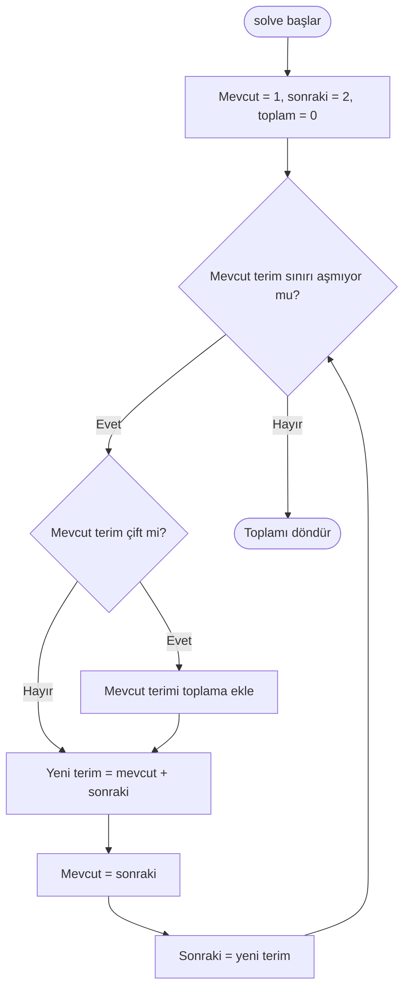

# Problem 2 — Çift Fibonacci sayıları

[Kod dosyası](Problem2.cpp) · [Problemin aslı](https://projecteuler.net/problem=2)

## Amaç

1 ve 2 ile başlayan Fibonacci dizisinde, dört milyonu aşmayan çift terimlerin toplamını bulmak.

**Girdi:** 4000000 (üst sınır dahil). **Çıktı:** `Sonuç: 4613732`.

## Çözümün mantığı

1. Ardışık iki terimi 1 ve 2, toplamı 0 olarak başlat.
2. Mevcut terim sınırı aşmıyorsa çift olup olmadığını kontrol et.
3. Çiftse toplama ekle.
4. Ardışık iki terimi toplayarak yeni terimi bul ve dizide ilerle.
5. Mevcut terim sınırı aştığında toplamı döndür.

Tüm diziyi saklamaya gerek yoktur. Yalnızca ardışık iki terim ve ilerleme sırasında geçici bir değer kullanılır.

## Sınıfın görevleri

| Kod öğesi | Görevi |
| --- | --- |
| `limit_` | Üst sınırı saklayan özel üye |
| `Problem2Solver(int limit)` | Sınırı dışarıdan alan kurucu |
| `isEven()` | Sayının çift olup olmadığını kontrol eder |
| `advanceFibonacci()` | Referansla aldığı iki terimi günceller |
| `solve()` | Uygun çift terimleri toplar ve sonucu döndürür |
| `main()` | Nesneyi oluşturur ve sonucu yazdırır |

Üst sınır `int`; Fibonacci terimleri ve toplam `long long` türündedir.

## Akış şeması

Şema `solve()` metodunu ve çağırdığı yardımcı işlemleri gösterir. Sınır kurucuda alınır; döndürülen sonuç `main()` içinde yazdırılır.



## Küçük örnek

Sınır 100 olduğunda değerlendirilen terimler:

1, **2**, 3, 5, **8**, 13, 21, **34**, 55, 89.

Çift terimlerin toplamı **2 + 8 + 34 = 44** olur. Bir sonraki terim 144 olduğundan döngü sona erer.

Sınır 2 ise sonuç 2; sınır 2'den küçükse sonuç 0 olur.

## Maliyet

Pozitif ve büyüyen sınırlar için zaman karmaşıklığı O(log sınır), ek bellek kullanımı O(1)'dir.

## Çalıştırma

Deponun ana klasöründe:

```bash
mkdir -p build
g++ -std=c++17 -Wall -Wextra hafta1-3/Problem2.cpp -o build/problem2
./build/problem2
```

[Ana sayfaya dön](../README.md)
