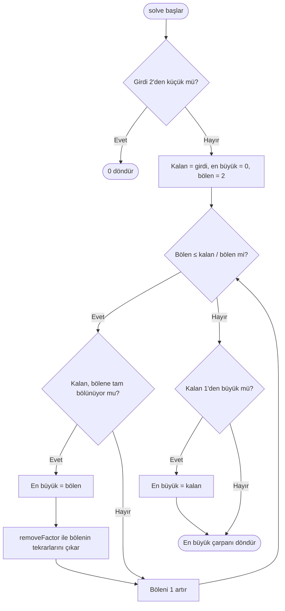
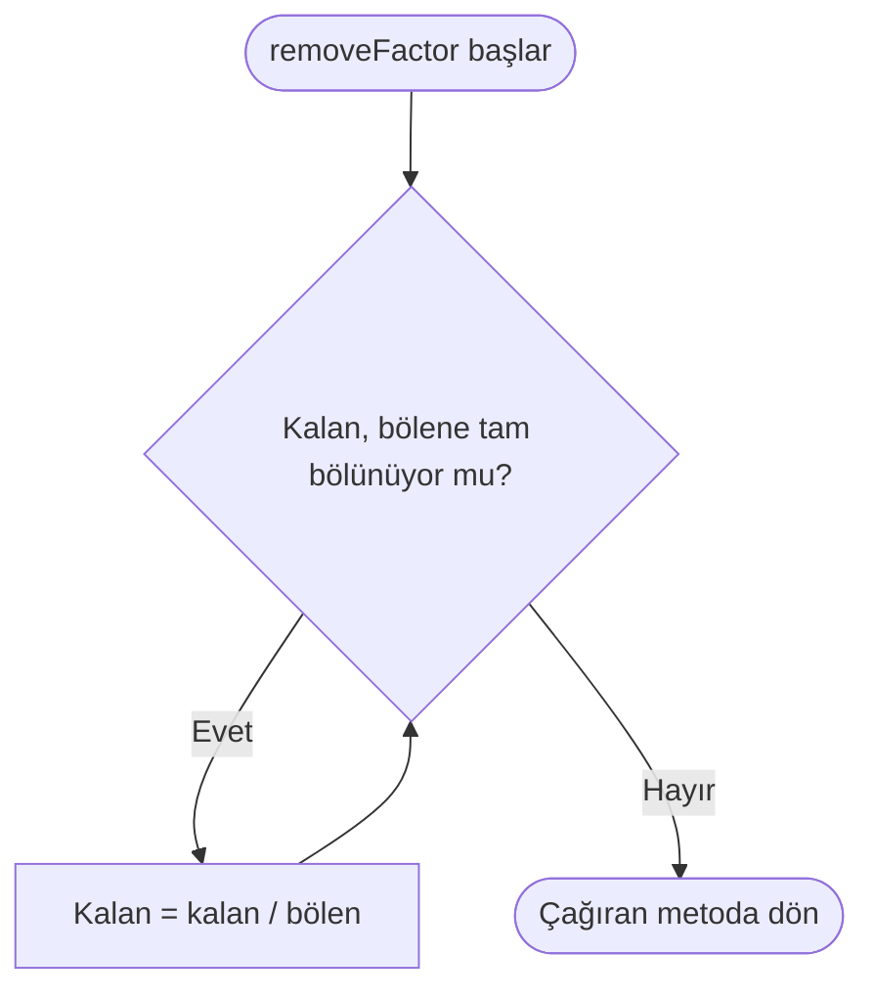

# Problem 3 — En büyük asal çarpan

[Kod dosyası](Problem3.cpp) · [Problemin aslı](https://projecteuler.net/problem=3)

## Amaç

600851475143 sayısının en büyük asal çarpanını bulmak.

**Girdi:** 600851475143. **Çıktı:** `Sonuç: 6857`.

## Çözümün mantığı

1. Girdi 2'den küçükse asal çarpan olmadığını belirtmek için 0 döndür.
2. Girdiyi yerel bir kalan değişkenine kopyala ve bölenleri 2'den başlayarak dene.
3. Tam bölünme bulunduğunda en büyük çarpanı güncelle; bu bölenin tüm tekrarlarını kalandan çıkar.
4. Bölen, kalan sayının karekökünü aştığında aramayı bitir.
5. Kalan değer 1'den büyükse bu değer asaldır ve en büyük asal çarpandır.

Küçük çarpanların tüm tekrarları önceden çıkarıldığı için daha sonra bulunan bölenler asaldır. Ayrı bir asal sayı kontrolüne gerek yoktur.

## Sınıfın görevleri

| Kod öğesi | Görevi |
| --- | --- |
| `number_` | Asıl girdiyi saklayan özel üye |
| `Problem3Solver(long long number)` | Sayıyı dışarıdan alan kurucu |
| `removeFactor()` | Bir bölenin tüm tekrarlarını kalandan çıkarır |
| `solve()` | En büyük asal çarpanı bulup döndürür |
| `main()` | Nesneyi oluşturur ve sonucu yazdırır |

Girdi büyük olduğu için `long long` kullanılır. `number_` değiştirilmez; işlemler yerel `remaining` değişkeni üzerinde yapılır.

## Ana akış şeması

Şema `solve()` metodunu gösterir. Girdi kurucuda alınır, döndürülen sonuç `main()` içinde yazdırılır.

Döngüdeki `factor <= remaining / factor` koşulu, pozitif değerler için karekök sınırını uygular. `factor * factor` hesaplanmadığından çarpma taşması önlenir.

## Yardımcı metodun akışı

`removeFactor()` yalnızca tam bölünme bulunduğunda çağrılır. Kalan değer referansla güncellenir.

## Küçük örnek

13195 için çarpan çıkarma adımları:

| Bulunan bölen | Bölme sonrası kalan | O ana kadarki en büyük çarpan |
| --- | --- | --- |
| 5 | 2639 | 5 |
| 7 | 377 | 7 |
| 13 | 29 | 13 |

Arama sona erdiğinde kalan 29, 1'den büyüktür. Sonuç **29** olarak güncellenir.

49 için 7 iki kez çıkarılır, kalan 1 olur ve sonuç 7'dir. 97 gibi asal bir girdide hiçbir bölen bulunmaz; kalan girdinin kendisidir ve sonuç 97 olur.

[Ana sayfaya dön](../README.md)
